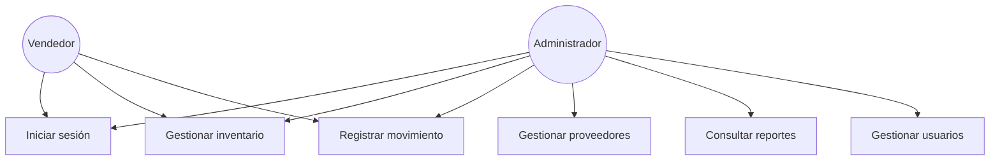

# Fase 1 — Análisis

## 1.1 Descripción general

FerreControl es un sistema web para la gestión de inventario, proveedores y
movimientos de mercancía en una ferretería. Permite controlar existencias,
registrar entradas y salidas con validación automática de stock, y generar
reportes básicos de rendimiento, todo con control de acceso diferenciado por
rol.

## 1.2 Actores del sistema

| Actor | Descripción | Acceso |
|---|---|---|
| Administrador | Gestiona todo el sistema: inventario, movimientos, proveedores, reportes y usuarios | Total |
| Vendedor | Opera el día a día: consulta y registra movimientos de inventario | Parcial (sin Proveedores, Reportes ni Usuarios) |

## 1.3 Alcance

**Incluido en esta versión:**
- Autenticación de usuarios (correo + contraseña, con token de sesión)
- Consulta y registro de productos
- Registro de entradas/salidas de mercancía con validación de stock disponible
- Gestión de proveedores (consulta y registro)
- Reportes básicos: valor de inventario, productos más vendidos, alertas de stock bajo
- Gestión de usuarios y roles (solo consulta desde la interfaz por ahora)
- Modo oscuro persistente y detección de estado de conexión

**Fuera de alcance por ahora** (ver `03-desarrollo/01-manual-tecnico.md` para
el detalle técnico de qué falta):
- Edición y eliminación de productos/proveedores desde la interfaz
- Registro de nuevos usuarios desde la interfaz
- Facturación / punto de venta
- Reportes exportables a PDF/Excel (el botón existe, la exportación real no)

## 1.4 Requerimientos funcionales

| ID | Requerimiento | Actor |
|---|---|---|
| RF-01 | El sistema debe permitir iniciar sesión con correo y contraseña | Todos |
| RF-02 | El sistema debe rechazar credenciales incorrectas mostrando un mensaje de error, sin revelar si falló el correo o la contraseña | Todos |
| RF-03 | El sistema debe mostrar solo las opciones de menú permitidas según el rol del usuario autenticado | Todos |
| RF-04 | El sistema debe listar los productos del inventario con su código, nombre, categoría, stock y estado | Todos |
| RF-05 | El sistema debe permitir registrar un nuevo producto indicando código SKU, nombre, precio y stock inicial | Administrador, Vendedor |
| RF-06 | El sistema debe permitir registrar movimientos de entrada y salida de mercancía | Administrador, Vendedor |
| RF-07 | El sistema debe impedir registrar una salida si la cantidad solicitada supera el stock disponible | Administrador, Vendedor |
| RF-08 | El sistema debe actualizar automáticamente el stock del producto al registrar un movimiento | Sistema |
| RF-09 | El sistema debe permitir consultar y registrar proveedores | Administrador |
| RF-10 | El sistema debe mostrar reportes de valor de inventario, productos más vendidos y alertas de reabastecimiento | Administrador |
| RF-11 | El sistema debe listar los usuarios registrados con su rol y estado | Administrador |
| RF-12 | El sistema debe permitir alternar entre modo claro y oscuro, recordando la preferencia entre sesiones | Todos |

## 1.5 Requerimientos no funcionales

| ID | Requerimiento |
|---|---|
| RNF-01 | Las contraseñas deben almacenarse cifradas (bcrypt), nunca en texto plano |
| RNF-02 | Las sesiones deben expirar automáticamente (token JWT válido por 8 horas) |
| RNF-03 | El sistema debe limitar los intentos de inicio de sesión para dificultar ataques de fuerza bruta |
| RNF-04 | La interfaz debe ser utilizable con lector de pantalla (etiquetas asociadas, roles ARIA, anuncios en vivo para cambios de estado) |
| RNF-05 | La interfaz debe adaptarse a pantallas móviles y de escritorio |
| RNF-06 | El sistema debe informar visualmente cuando se pierde la conexión a internet |
| RNF-07 | Las operaciones que modifican el stock deben ser atómicas (si falla un paso, no debe quedar el inventario descuadrado) |

## 1.6 Casos de uso principales

