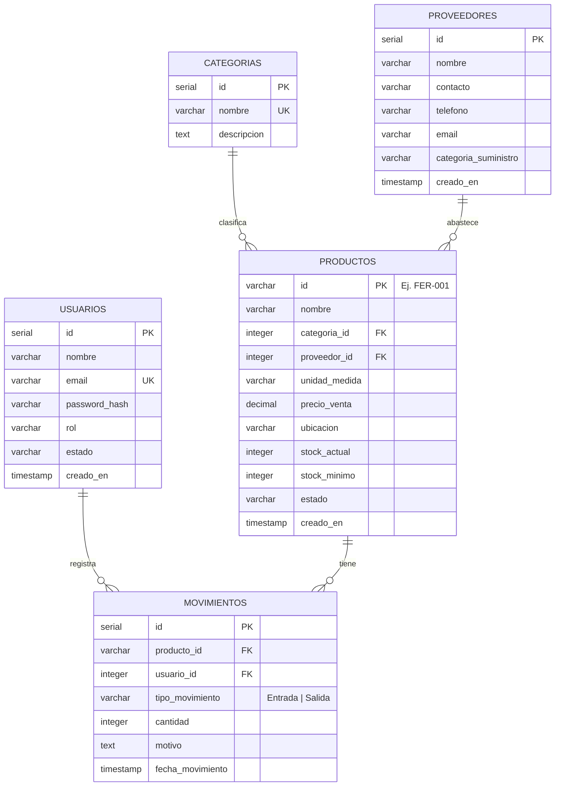

# Diagrama Entidad-Relación

Refleja exactamente las tablas definidas en `database/schema.sql`.

## Notas de diseño

- `productos.id` es un código legible (`FER-001`) en vez de un entero
  autoincremental, porque así lo maneja el negocio (el SKU es el
  identificador natural del producto).
- `productos.estado` se recalcula automáticamente en el backend cada vez que
  cambia el stock (ver `POST /api/movimientos` en el manual técnico), no lo
  edita el usuario directamente.
- `movimientos.usuario_id` se llena con el usuario autenticado (extraído del
  token JWT), nunca con un valor que mande el frontend — así se garantiza
  trazabilidad real de quién hizo cada movimiento.
- Los índices sobre `productos(categoria_id)`, `productos(proveedor_id)`,
  `movimientos(producto_id)` y `movimientos(fecha_movimiento)` existen porque
  son las columnas que más se filtran/ordenan en las consultas del backend.
