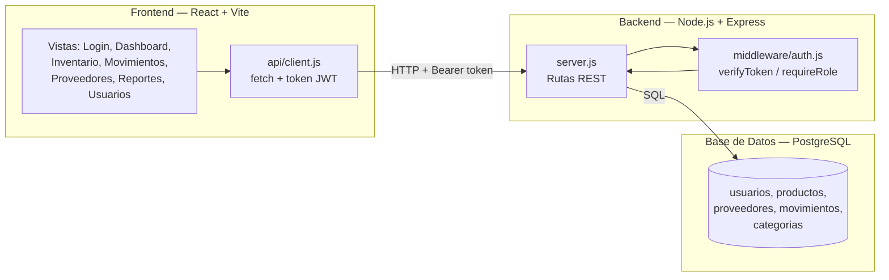
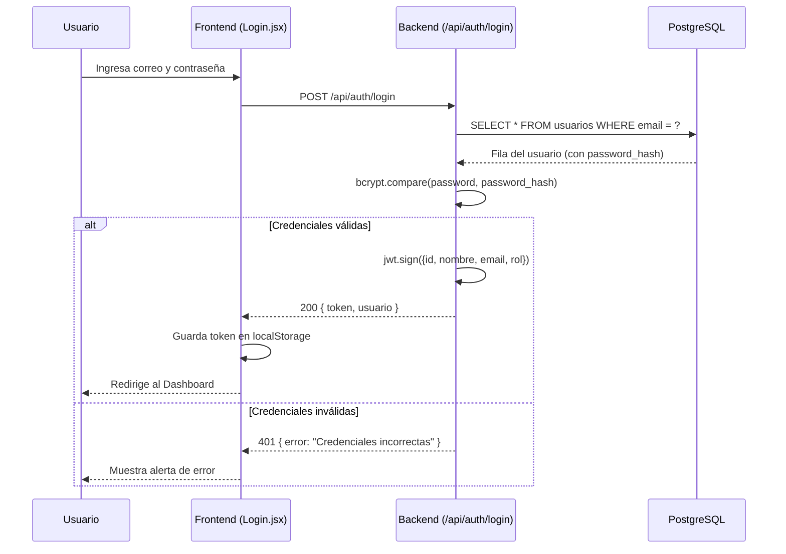
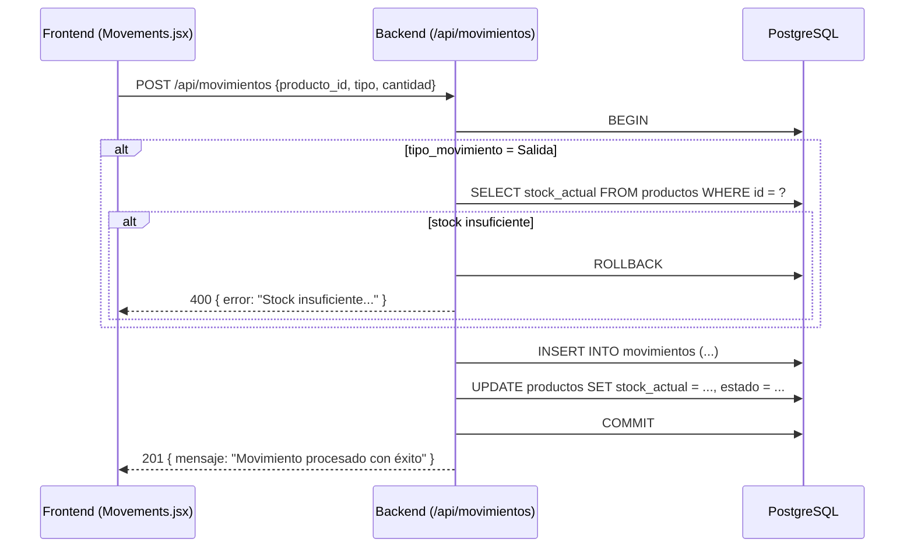

# Arquitectura del sistema

## Vista general (3 capas)

## Flujo de autenticación

## Flujo de un movimiento de inventario (transaccional)

## Por qué esta arquitectura

- **Separación en 3 capas** — permite que el frontend, backend y base de
  datos se entreguen y versionen por separado (útil para trabajo en equipo:
  uno puede tocar el frontend sin afectar el backend).
- **Middleware de autenticación centralizado** (`verifyToken`,
  `requireRole`) — evita repetir la validación de token en cada ruta; las
  rutas solo declaran qué rol necesitan.
- **Transacciones SQL en movimientos** — si el servidor falla a mitad de un
  registro de entrada/salida, la base de datos vuelve al estado anterior
  (`ROLLBACK`) en vez de quedar con el stock descuadrado.
