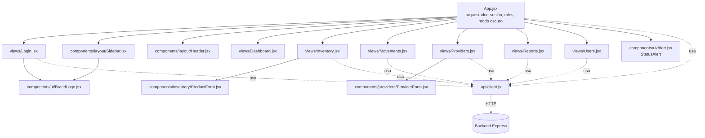

# Diagrama de componentes (Frontend)

## Nota sobre el "diagrama de clases"

Este proyecto no usa clases en el sentido UML/POO tradicional: el backend
está escrito con funciones y rutas de Express (no hay clases `Producto`,
`Usuario`, etc. en el código), y el frontend usa componentes funcionales de
React. Por eso, en vez de forzar un diagrama de clases que no representaría
el código real, se documenta como **diagrama de componentes**, que sí es
fiel a `frontend/src/`. El Diagrama Entidad-Relación (`01-diagrama-er.md`)
cumple el rol que normalmente cubriría un diagrama de clases para el modelo
de datos.

## Árbol de componentes

## Responsabilidad de cada capa

| Carpeta | Responsabilidad |
|---|---|
| `views/` | Una vista completa por módulo del sistema (una por cada opción del Sidebar) |
| `components/layout/` | Piezas de la interfaz que se mantienen visibles siempre (Sidebar, Header) |
| `components/ui/` | Piezas reutilizables sin lógica de negocio (logo, alertas) |
| `components/inventory/`, `components/providers/` | Formularios específicos de un módulo |
| `api/client.js` | Único punto de contacto con el backend; centraliza el manejo del token JWT |
